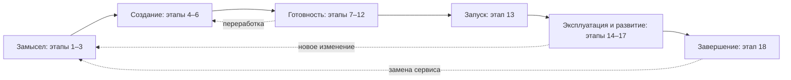

# SERVICE_LIFECYCLE_REGULATION

## Назначение

Этот документ задает жизненный цикл сервиса при явном выборе этого процесса в `PROJECT.md`: от появления идеи и решения о создании или покупке до эксплуатации, развития и управляемого вывода из эксплуатации.

Регламент является основополагающим для развития сервиса. Проектные решения, планы, спринты, релизы и изменения должны соответствовать текущему этапу жизненного цикла и критериям перехода между этапами.

Регламент отвечает на четыре обязательных вопроса:

- какие этапы уже завершены;
- на каком одном или нескольких этапах сервис находится сейчас;
- какие этапы заблокированы;
- какие этапы еще осталось пройти.

Правила жизненного цикла хранятся в этом документе. Фактические статусы конкретного сервиса ведутся в разделе `Жизненный цикл проекта` файла [`STATE.md`](../../01-product/strategy/STATE.md).

## Выбор процесса

Этот регламент применяется к проектам, для которых в [PROJECT.md](../../01-product/strategy/PROJECT.md) явно выбран процесс сервиса. Типы продуктов и подключение описаны в [каталоге профилей](../../07-project-types/README.md).

**Для игры действует отдельный [игровой регламент из 17 этапов](../../07-project-types/games/GAME_LIFECYCLE.md). Этот сервисный процесс не добавляет к игре ещё 18 обязательных этапов и не отменяет её остановки для проверки пользователя.** Будущий отдельный веб-профиль ещё не описан; веб-сервис может использовать этот документ по явному выбору.

## Область применения

В рамках выбранного процесса регламент применяется к создаваемым, покупаемым, внедряемым и эксплуатируемым сервисам независимо от платформы и способа поставки: Web, backend, Android, iOS, macOS, Windows, внутренний инструмент, интеграция, библиотека или внешний SaaS.

Регламент обязателен:

- при запуске нового проекта;
- при покупке или внедрении готового решения;
- при существенном изменении существующего сервиса;
- при переносе сервиса на другую платформу или инфраструктуру;
- при подготовке к завершению или замене сервиса.

У сервиса может быть несколько компонентов и платформ. Для них допускаются разные фактические состояния, если это явно отражено в реестре и не скрывает общие зависимости или риски.

## Владение и ответственность

- Владелец регламента: CEO Agent.
- Владелец продукта отвечает за бизнес-результат, приоритеты и решения о переходах.
- Product Manager Agent отвечает за требования, пользователей, scope и продуктовые критерии.
- CTO Agent и Tech Lead Agent отвечают за архитектуру, реализацию, технические риски и готовность к эксплуатации.
- Analyst Agent отвечает за baseline, метрики, качество данных и подтверждение эффекта.
- QA Agent отвечает за доказательства качества и критерии приемки.
- Security Agent отвечает за безопасность и персональные данные.
- DevOps Agent отвечает за инфраструктуру, публикацию, наблюдаемость, восстановление и техническое завершение.
- Documentation Agent отвечает за актуальность source of truth и ссылок на подтверждающие материалы.

Роли можно совмещать, но у каждого активного этапа должен быть один явно назначенный owner.

## Модель жизненного цикла

Жизненный цикл состоит из 18 этапов, объединенных в шесть частей:

| Часть | Этапы | Результат части |
| --- | --- | --- |
| Замысел | 1. Инициирование и экономика; 2. Создание или покупка; 3. Требования и платформы | Решение о сервисе обосновано, способ получения выбран, требования согласованы. |
| Создание | 4. Архитектура и инфраструктура; 5. Дизайн и интерфейс; 6. Разработка | Рабочая версия сервиса создана на согласованной основе. |
| Готовность | 7. Монетизация; 8. Безопасность и персональные данные; 9. Юридическая проверка; 10. Оптимизация; 11. Настройка аналитики; 12. Тестирование | Сервис готов к контролируемой публикации и измерению результата. |
| Запуск | 13. Публикация | Версия доступна целевой аудитории и контролируется командой. |
| Эксплуатация и развитие | 14. Эксплуатация и поддержка; 15. Аналитика после запуска; 16. A/B-тестирование; 17. Улучшение | Сервис стабильно работает и развивается на основании данных и обратной связи. |
| Завершение | 18. Вывод из эксплуатации и архивирование | Пользователи, данные и обязательства безопасно переведены или закрыты; активы архивированы. |

## Статусы этапов

Используются статусы, совместимые с остальными документами репозитория:

| Статус | Значение |
| --- | --- |
| `todo` | Этап применим, но еще не начат. |
| `doing` | Работа этапа выполняется. |
| `review` | Результат этапа проверяется или ожидает решения о переходе. |
| `done` | Критерий завершения выполнен и подтверждение сохранено. |
| `blocked` | Этап начат, но продолжение невозможно без решения или снятия зависимости. |
| `n/a` | Этап неприменим; причина и лицо, принявшее решение, зафиксированы. |

Состояние сервиса определяется так:

- текущие этапы — все строки со статусами `doing`, `review` или `blocked`;
- завершенные этапы — все строки со статусом `done`;
- оставшиеся этапы — все строки со статусом `todo`;
- исключенные этапы — все строки со статусом `n/a`.

Несколько этапов могут выполняться параллельно. В этом случае каждый из них получает собственный статус, owner, срок и подтверждение. Параллельность не отменяет зависимости и критерии перехода.

Если позднее изменение затрагивает уже принятый результат, соответствующий этап повторно открывается в статусе `doing` или `review`.

## Реестр жизненного цикла

Для каждого сервиса CEO Agent создает и поддерживает полный реестр из 18 строк в [`STATE.md`](../../01-product/strategy/STATE.md).

В каждой строке обязательны:

- номер и название этапа;
- фактический статус;
- один owner;
- срок или дата следующего решения для активного этапа;
- ссылка на результат, решение, документ или другое проверяемое подтверждение;
- дата последнего обновления.

Реестр обновляется:

- при создании сервиса;
- при начале, блокировке, возобновлении или завершении этапа;
- при изменении owner, scope, платформы или критерия завершения;
- после существенного решения, релиза или инцидента;
- не реже одного раза в неделю, пока есть активная работа.

Пустой статус, устаревшая дата или завершение без подтверждения считаются нарушением регламента.

## Правила переходов

1. Этап начинается только после назначения owner и фиксации ожидаемого результата.
2. Этап получает `done` только после выполнения контрольной точки и сохранения подтверждения.
3. Блокировка фиксируется статусом `blocked`, причиной, влиянием и условием разблокировки.
4. Этап можно пометить `n/a` только явным решением CEO Agent или владельца продукта с записанной причиной.
5. Рискованный пропуск действия не превращает этап в `done`; принятый риск фиксируется отдельно.
6. Изменение, нарушающее результат завершенного этапа, повторно открывает этот этап и все зависимые проверки.
7. Спринты организуют выполнение работ, но не заменяют жизненный цикл сервиса. Один этап может занимать несколько спринтов, а один спринт — продвигать несколько этапов.
8. Сервис не считается управляемым, если по реестру нельзя однозначно определить текущие и оставшиеся этапы.

## Обязательные этапы

### 1. Инициирование и экономика

**Цель:** подтвердить проблему, ценность и экономический смысл сервиса.

Минимальные действия:

1. Описать проблему, целевую аудиторию и ключевой сценарий.
2. Зафиксировать ожидаемую ценность, затраты, ограничения и критерии успеха.
3. Проверить альтернативы, зависимости и основные риски.
4. Назначить владельцев продукта, технологий, качества и операций.

**Контрольная точка:** принято обоснованное решение продолжить, отложить или остановить инициативу.

**Подтверждение:** заполненные [`PROJECT.md`](../../01-product/strategy/PROJECT.md), цели, владельцы, ограничения и решение CEO Agent.

### 2. Создание или покупка

**Цель:** выбрать способ получения сервиса.

Минимальные действия:

1. Сравнить собственную разработку, покупку, аренду, интеграцию и комбинированный вариант.
2. Оценить стоимость владения, сроки, зависимость от поставщика и возможность выхода.
3. Проверить безопасность, лицензии, экспорт данных, SLA и поддержку.
4. Зафиксировать решение и причины отказа от альтернатив.

**Контрольная точка:** выбран способ получения сервиса, совместимый с целями и ограничениями.

**Подтверждение:** сравнительная оценка и утвержденное решение `build | buy | integrate | hybrid`.

### 3. Требования и платформы

**Цель:** определить, что должен делать сервис и где он должен работать.

Минимальные действия:

1. Зафиксировать функциональные и нефункциональные требования.
2. Описать пользовательские сценарии, acceptance criteria и границы scope.
3. Выбрать платформы, устройства, версии, языки, страны и требования доступности.
4. Определить интеграции, данные, ограничения и критерии совместимости.

**Контрольная точка:** требования проверяемы, согласованы и достаточны для проектирования.

**Подтверждение:** [`REQUIREMENTS.md`](../../01-product/requirements/REQUIREMENTS.md), [`USER_FLOWS.md`](../../01-product/requirements/USER_FLOWS.md) и принятое решение о платформах.

### 4. Архитектура и инфраструктура

**Цель:** создать техническую основу, выдерживающую согласованные нагрузки, развитие и восстановление.

Минимальные действия:

1. Определить компоненты, API, данные, интеграции, права доступа и границы ответственности.
2. Выбрать технологии с учетом компетенций, стоимости, поддержки и рисков зависимости.
3. Разделить окружения и настроить сборку, поставку, секреты и конфигурацию.
4. Спроектировать масштабирование, наблюдаемость, резервное копирование и восстановление.

**Контрольная точка:** архитектура согласована, критические зависимости и стоимость эксплуатации подтверждены.

**Подтверждение:** [`ARCHITECTURE.md`](../../03-engineering/architecture/ARCHITECTURE.md), [`STACK.md`](../../03-engineering/stack/STACK.md) и принятые ADR.

### 5. Дизайн и интерфейс

**Цель:** сделать ключевые сценарии понятными, согласованными и доступными.

Минимальные действия:

1. Построить карту сценариев, экранов, состояний, ошибок и пустых данных.
2. Проверить прототипы на представителях целевой аудитории.
3. Зафиксировать компоненты, типографику, цвета, отступы и правила поведения.
4. Проверить адаптивность, клавиатурную навигацию, контраст и масштабирование текста.

**Контрольная точка:** ключевые сценарии проверены, а макеты и компоненты готовы к разработке.

**Подтверждение:** карта сценариев, прототипы, результаты проверок и согласованные макеты.

### 6. Разработка

**Цель:** создать рабочую версию сервиса согласно требованиям и архитектуре.

Минимальные действия:

1. Декомпозировать scope на проверяемые задачи с owners и критериями приемки.
2. Реализовать клиентские, серверные, интеграционные и инфраструктурные изменения.
3. Выполнять автоматические проверки, self-review и профильное review.
4. Поддерживать документацию кода, API, конфигурации и миграций.

**Контрольная точка:** согласованный инкремент собран, повторяемо проверяется и готов к независимому тестированию.

**Подтверждение:** задачи, изменения, результаты CI, review и техническая документация.

### 7. Монетизация

**Цель:** реализовать и проверить выбранную экономическую модель сервиса.

Минимальные действия:

1. Выбрать модель: покупка, подписка, реклама, комиссия, платные функции или бесплатный сервис.
2. Определить тарифы, ограничения, пробный период, возвраты и смену плана.
3. Учесть комиссии, налоги, валюты, чеки и правила платежных платформ.
4. Проверить платежи, права пользователя, возвраты и события аналитики.

**Контрольная точка:** полный денежный сценарий проверен на каждой применимой платформе.

**Подтверждение:** [`MONETIZATION.md`](../../01-product/growth/MONETIZATION.md), договоры, тестовые платежи и результаты проверок.

### 8. Безопасность и персональные данные

**Цель:** снизить угрозы до принятого уровня и защитить данные на всем жизненном цикле.

Минимальные действия:

1. Составить реестр данных, получателей, мест хранения, сроков и оснований обработки.
2. Провести моделирование угроз для учетных записей, API, устройств, платежей и администрирования.
3. Настроить минимальные права, безопасное хранение секретов, журналы и оповещения.
4. Проверить код, зависимости, конфигурацию, инфраструктуру, резервные копии и восстановление.

**Контрольная точка:** нет непринятых критических рисков, а реагирование и восстановление проверены.

**Подтверждение:** [`SECURITY.md`](../../05-operations/SECURITY.md), модель угроз, реестр данных, результаты проверок и принятые риски.

### 9. Юридическая проверка

**Цель:** подтвердить допустимость работы сервиса в выбранных юрисдикциях и каналах поставки.

Минимальные действия:

1. Проверить права на код, контент, название, домены, изображения, шрифты и сторонние компоненты.
2. Определить применимые страны, возрастные ограничения и правила защиты потребителей и данных.
3. Подготовить политику конфиденциальности, пользовательские условия и правила платежей.
4. Проверить формы согласия, cookie, рекламу, лицензии и передачу данных партнерам.

**Контрольная точка:** юрист или назначенный ответственный подтвердил готовность для целевых юрисдикций.

**Подтверждение:** юридический реестр, утвержденные документы, лицензии и записанное заключение.

### 10. Оптимизация

**Цель:** обеспечить приемлемую скорость, устойчивость и стоимость работы сервиса.

Минимальные действия:

1. Установить измеримые цели скорости запуска, отклика, стабильности, размера и потребления ресурсов.
2. Найти узкие места на реальных устройствах, в сетях и на ожидаемых объемах данных.
3. Оптимизировать критические запросы, загрузку, кэширование, фоновые операции и клиентские ресурсы.
4. Зафиксировать исходные и итоговые показатели.

**Контрольная точка:** целевые показатели достигнуты либо отклонения явно приняты владельцем.

**Подтверждение:** результаты измерений, нагрузочные проверки и решения по известным ограничениям.

### 11. Настройка аналитики

**Цель:** обеспечить измеримость поведения пользователей, качества сервиса и бизнес-результата.

Минимальные действия:

1. Определить основные метрики, guardrails и недопустимые ухудшения.
2. Описать события, свойства, идентификаторы и правила связи данных между платформами.
3. Построить воронки, сегменты, отчеты и контроль качества поступающих данных.
4. Проверить согласия, минимизацию данных, сроки хранения и сверку с платежными источниками.

**Контрольная точка:** события поступают без критических дублей и потерь, а ключевые показатели воспроизводимы.

**Подтверждение:** [`ANALYTICS.md`](../../01-product/growth/ANALYTICS.md), словарь событий, результаты QA данных и ссылки на панели.

### 12. Тестирование

**Цель:** доказать готовность версии на поддерживаемых платформах и критических сценариях.

Минимальные действия:

1. Составить план по требованиям, платформам, устройствам, версиям, языкам и типам сети.
2. Проверить функции, интеграции, данные, миграции, платежи, уведомления и администрирование.
3. Провести применимые проверки производительности, нагрузки, безопасности и доступности.
4. Проверить резервное копирование, восстановление, rollback, установку, обновление и удаление.

**Контрольная точка:** blocking-дефектов нет, известные ограничения приняты, решение о выпуске подписано ответственными.

**Подтверждение:** [`TESTING.md`](../../04-quality/TESTING.md), тест-план, результаты проверок, дефекты и решение `go | no-go`.

### 13. Публикация

**Цель:** контролируемо доставить проверенную версию целевой аудитории.

Минимальные действия:

1. Подготовить окружение, домены, сертификаты, карточки, подписи и каналы поддержки.
2. Проверить конфигурацию, секреты, платежи, аналитику, юридические ссылки и резервные копии.
3. Зафиксировать owner, окно работ, критерии остановки, rollback и коммуникацию.
4. Выпускать постепенно, если риск и инфраструктура требуют поэтапного запуска.
5. Выполнить post-release smoke и усиленное наблюдение.

**Контрольная точка:** версия доступна в выбранном канале, критические показатели стабильны, rollback и owner подтверждены.

**Подтверждение:** [`RELEASE_CHECKLIST.md`](../../05-operations/RELEASE_CHECKLIST.md), карточка выпуска, версия, URL, журнал запуска и результаты smoke.

### 14. Эксплуатация и поддержка

**Цель:** стабильно предоставлять сервис и управляемо реагировать на проблемы.

Минимальные действия:

1. Назначить дежурных, каналы обращений, уровни критичности и порядок эскалации.
2. Контролировать доступность, ошибки, скорость, инфраструктуру, платежи и фоновые задачи.
3. Проверять резервные копии, восстановление, зависимости и операционные системы.
4. Вести журнал инцидентов, причин, исправлений и профилактических действий.
5. Контролировать расходы и отключать неиспользуемые ресурсы и доступы.

**Контрольная точка:** поддержка, наблюдение, восстановление, обновления и эскалация работают по проверенным правилам.

**Подтверждение:** [`OBSERVABILITY.md`](../../05-operations/OBSERVABILITY.md), [`TROUBLESHOOTING.md`](../../05-operations/TROUBLESHOOTING.md), график дежурств, журнал инцидентов и тесты восстановления.

### 15. Аналитика после запуска

**Цель:** понять фактическое поведение пользователей, бизнес-результат и точки потерь.

Минимальные действия:

1. Сверить данные продукта, платежей, рекламы, инфраструктуры и поддержки.
2. Проанализировать привлечение, активацию, ключевое действие, конверсию, удержание, доход и отток.
3. Сегментировать результаты по платформе, версии, стране, источнику, тарифу и значимым группам.
4. Отделить устойчивые изменения от случайных колебаний и ошибок измерения.

**Контрольная точка:** подготовлен регулярный отчет с проверенными данными, выводами и приоритетными возможностями улучшения.

**Подтверждение:** отчет по [`ANALYTICS_REPORT_TEMPLATE.md`](../templates/ANALYTICS_REPORT_TEMPLATE.md), панели, сверки и список гипотез.

### 16. A/B-тестирование

**Цель:** проверять продуктовые решения контролируемыми экспериментами, когда это допустимо и полезно.

Минимальные действия:

1. Зафиксировать гипотезу, аудиторию, основной показатель, guardrails и ожидаемый эффект.
2. Определить варианты, единицу распределения, размер выборки, длительность и критерии остановки.
3. Проверить распределение, события, пересечения экспериментов и аварийное отключение.
4. Не менять правила и не завершать тест только из-за промежуточного результата.
5. Сохранить вывод и решение: внедрить, повторить, изменить или отклонить.

**Контрольная точка:** эксперимент корректно завершен, а решение основано на заранее заданных критериях.

**Подтверждение:** карточка эксперимента, расчет, проверка качества, результат и принятое решение.

### 17. Улучшение

**Цель:** управляемо развивать сервис на основании данных, обратной связи, рисков и стратегии.

Минимальные действия:

1. Объединить выводы аналитики, экспериментов, исследований, обращений, инцидентов и безопасности.
2. Оценить инициативы по ценности, влиянию, срочности, риску, стоимости и зависимостям.
3. Назначить каждой принятой инициативе результат, метрику, owner, срок и критерий завершения.
4. Возвращать изменения в нужные этапы требований, проектирования, разработки, тестирования и публикации.

**Контрольная точка:** план следующего цикла утвержден, а приоритеты связаны с данными, ответственными и измеримым результатом.

**Подтверждение:** [`ROADMAP.md`](../../01-product/strategy/ROADMAP.md), [`BACKLOG.md`](../../01-product/planning/BACKLOG.md), решения по приоритетам и результаты предыдущего цикла.

### 18. Вывод из эксплуатации и архивирование

**Цель:** безопасно завершить или передать сервис без неуправляемых последствий для пользователей, данных и обязательств.

Минимальные действия:

1. Зафиксировать причину, объем и дату завершения; сравнить развитие, перенос, продажу, объединение и полный вывод.
2. Провести инвентаризацию пользователей, данных, подписок, платежей, договоров, доменов, приложений, инфраструктуры, интеграций и зависимых сервисов.
3. Утвердить план перехода: уведомления, экспорт или перенос данных, альтернативный сервис, возвраты и срок поддержки.
4. Остановить привлечение, новые оплаты, продления, рекламу и выдачу прав в согласованные сроки.
5. Архивировать или удалить данные по установленным срокам; отозвать доступы, ключи и сертификаты.
6. Отключить инфраструктуру после проверки зависимостей и контролировать остаточные списания, обращения и риски.

**Контрольная точка:** решение утверждено; пользователи уведомлены; перенос, возвраты и обязательства выполнены; данные обработаны; доступы отозваны; инфраструктура отключена; owners остаточного периода назначены.

**Подтверждение:** решение о завершении, оценка влияния, план коммуникации и перехода, подтверждения обработки данных, закрытия платежей и договоров, реестр отозванных доступов и итоговый отчет.

## Управление изменениями

- Любое изменение цели, платформы, архитектуры, способа монетизации, состава данных или модели эксплуатации проверяется на влияние на реестр жизненного цикла.
- CEO Agent определяет, какие завершенные этапы нужно повторно открыть.
- Результаты спринтов фиксируются по [`SPRINT_REGULATION.md`](SPRINT_REGULATION.md), а влияние на жизненный цикл — в [`STATE.md`](../../01-product/strategy/STATE.md).
- Существенные решения сохраняются в `Последних решениях` файла [`STATE.md`](../../01-product/strategy/STATE.md).
- Релизно значимые изменения добавляются в [`CHANGELOG.md`](../../06-history/CHANGELOG.md).

## Условия управляемого сервиса

Сервис считается управляемым, когда одновременно выполняются условия:

- полный реестр из 18 этапов существует и актуален;
- текущие, заблокированные, завершенные, исключенные и оставшиеся этапы однозначно определяются по статусам;
- у каждого активного этапа есть owner, следующий шаг и срок;
- у каждого завершенного этапа есть проверяемое подтверждение;
- параллельные работы и зависимости отражены явно;
- изменение результата повторно открывает затронутые этапы;
- завершение сервиса проводится через контролируемый вывод из эксплуатации и архивирование.
