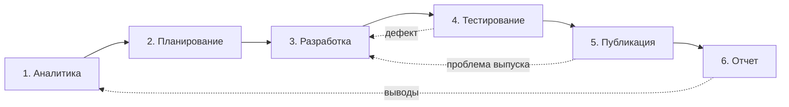

# SPRINT_REGULATION

## Назначение

Этот документ задает проектный регламент работы со спринтами. Он описывает обязательный сквозной цикл каждой итерации, точки перехода между этапами и правила адаптации процесса под продукт, команду и платформу.

Регламент настраивается один раз для конкретного проекта и применяется ко всем его спринтам. Экземпляр текущего спринта, статусы и подтверждения результатов ведутся в [`PLAN.md`](../../01-product/planning/PLAN.md).

## Владение и актуализация

- Владелец регламента: CEO Agent.
- Product Manager Agent отвечает за продуктовую постановку, планирование и решения по результатам анализа.
- Analyst Agent отвечает за качество данных, baseline, метрики успеха и аналитическую часть отчета.
- Tech Lead Agent отвечает за правила разработки и технические критерии переходов.
- QA Agent отвечает за quality gate тестирования.
- DevOps Agent или назначенный release owner отвечает за правила публикации.
- Роли можно совмещать, но ответственность за результат каждого этапа должна быть назначена явно.
- Регламент проверяется перед первым спринтом, после существенного вывода из отчета и при изменении платформы, release flow или состава команды.

## Главный принцип

Каждый спринт обязательно проходит все шесть этапов:

Этап можно адаптировать под специфику проекта, но нельзя удалить или молча пропустить. Для каждого этапа в текущем спринте должны быть зафиксированы:

- owner;
- входные данные;
- ожидаемый результат;
- критерий завершения;
- статус;
- ссылка на результат или иное подтверждение выполнения.

Не каждая отдельная задача обязана проходить все шесть этапов самостоятельно. Все этапы проходят спринт как единая итерация.

## Что настраивается для проекта

Перед первым спринтом CEO Agent, Product Manager Agent и Tech Lead Agent заполняют проектные правила. При смене платформы, release flow или состава команды правила пересматриваются.

### Общие параметры

- Длительность спринта:
- Ритм и даты церемоний:
- Рабочие дни и часовой пояс:
- Owner спринта по умолчанию:
- Инструмент учета задач:
- Обязательные окружения:
- Целевой канал публикации:
- Критерий завершения публикации:
- Правило срочных изменений scope:
- Место хранения отчета:

### Настройка этапов

| Этап | Проектные действия | Owner / участники | Обязательный результат | Критерий завершения | Документы / инструменты |
| --- | --- | --- | --- | --- | --- |
| Аналитика |  |  |  |  |  |
| Планирование |  |  |  |  |  |
| Разработка |  |  |  |  |  |
| Тестирование |  |  |  |  |  |
| Публикация |  |  |  |  |  |
| Отчет |  |  |  |  |  |

В последнем столбце можно указывать относительные ссылки на документы репозитория и внешние ссылки на tracker, макеты, CI/CD, аналитические панели или консоли публикации. Секреты, токены и пароли в регламент не добавляются.

## Обязательные этапы

### 1. Аналитика

**Цель:** понять, какую проблему решает спринт, для кого, зачем сейчас и как будет измерен результат.

Минимальные действия:

1. Проверить состояние продукта, обратную связь, метрики и итоги предыдущего спринта.
2. Проверить свежесть, полноту и сопоставимость данных, используемых для решения.
3. Уточнить цель, ограничения, зависимости и допущения.
4. Определить требования, baseline, метрики успеха и критерии приемки.
5. Зафиксировать риски и вопросы, влияющие на scope.

Обязательный результат:

- сформулированная цель спринта;
- подтвержденные требования или ссылки на них;
- измеримый ожидаемый результат;
- список ограничений, зависимостей и открытых вопросов.

Этап завершен, когда данных достаточно для принятия решения о составе спринта. Источниками могут быть [`PROJECT.md`](../../01-product/strategy/PROJECT.md), [`STATE.md`](../../01-product/strategy/STATE.md), [`REQUIREMENTS.md`](../../01-product/requirements/REQUIREMENTS.md), [`ANALYTICS.md`](../../01-product/growth/ANALYTICS.md), исследования и проектные панели метрик.

### 2. Планирование

**Цель:** превратить результат аналитики в выполнимый план итерации.

Минимальные действия:

1. Определить scope и явно зафиксировать, что в него не входит.
2. Декомпозировать работу, назначить одного owner каждой задаче и проверить capacity.
3. Указать последовательные шаги, параллельные потоки, зависимости и handoff.
4. Запланировать проверки, публикацию и отчет, а не только разработку.
5. Проверить Definition of Ready.

Обязательный результат — заполненный текущий спринт в [`PLAN.md`](../../01-product/planning/PLAN.md), связанный с [`ROADMAP.md`](../../01-product/strategy/ROADMAP.md) и задачами из [`BACKLOG.md`](../../01-product/planning/BACKLOG.md).

Этап завершен, когда scope соответствует доступной capacity, владельцы и зависимости определены, а для всех шести этапов назначены результаты и критерии завершения.

### 3. Разработка

**Цель:** создать согласованный инкремент продукта и подготовить его к независимой проверке.

Состав этапа зависит от проекта и может включать код, конфигурацию, контент, дизайн, миграции, инфраструктуру или документацию.

Минимальные действия:

1. Реализовать задачи в пределах принятого scope.
2. Выполнить локальные проверки и self-review.
3. Провести code review или иной профильный review по риску.
4. Обновить связанные технические и продуктовые документы.

Этап завершен, когда инкремент собран, review выполнен, известные ограничения записаны и результат передан на тестирование. Инженерные правила задаются в [`CONVENTIONS.md`](../../04-quality/CONVENTIONS.md), [`REVIEW_POLICY.md`](REVIEW_POLICY.md) и профильных документах проекта.

### 4. Тестирование

**Цель:** получить доказательство, что инкремент соответствует требованиям и не создает неприемлемых регрессий.

Минимальные действия:

1. Проверить acceptance criteria.
2. Выполнить применимые автоматические и ручные проверки.
3. Провести regression и необходимые security / compatibility проверки.
4. Зафиксировать дефекты, решения по ним и результат повторной проверки.

Этап завершен, когда выполнен quality gate из [`TESTING.md`](../../04-quality/TESTING.md), отсутствуют непринятые блокирующие дефекты и есть решение о готовности к публикации. Найденный дефект возвращает затронутую работу в разработку, после исправления нужные проверки выполняются повторно.

### 5. Публикация

**Цель:** доставить проверенный результат в заранее определенный для проекта целевой канал.

Публикация настраивается по платформе, например:

| Тип проекта | Возможный целевой канал | Возможный критерий завершения |
| --- | --- | --- |
| Web / backend | Сервер, hosting, cloud environment | Версия доступна в целевом окружении, post-deploy smoke пройден |
| Android | Google Play Console | Сборка отправлена на review или опубликована в выбранном track — согласно правилу проекта |
| iOS / macOS | App Store Connect | Сборка отправлена на review или доступна пользователям — согласно правилу проекта |
| Desktop / library | Installer, package registry, release page | Артефакт опубликован, версия и checksum зафиксированы |
| Внутренний продукт / документация | Internal environment, knowledge base, согласованный артефакт | Результат доступен целевой аудитории и проверен |

До старта спринта проект обязан определить, что означает `done` для публикации. Для store-платформ это может быть отправка на review либо фактическая доступность пользователям; выбранное правило должно учитывать внешнее время модерации.

Минимальные действия:

1. Пройти применимые пункты [`RELEASE_CHECKLIST.md`](../../05-operations/RELEASE_CHECKLIST.md).
2. Выполнить проектный release / deployment flow.
3. Зафиксировать версию, build, URL, track или другой идентификатор поставки.
4. Провести post-publication smoke и проверить критичные сигналы.
5. Подготовить rollback или иное правило реакции на проблему.

Этап завершен только при достижении выбранного проектом критерия. Если выпуск заблокирован, этап и спринт получают статус `blocked`, а не закрываются как выполненные. Детали поставки хранятся в [`DEPLOYMENT.md`](../../05-operations/DEPLOYMENT.md) и документах конкретной платформы.

### 6. Отчет

**Цель:** сопоставить план и факт, зафиксировать поставленный результат и превратить выводы в следующие действия.

Минимальные действия:

1. Сравнить цель, scope, сроки и ожидаемый результат с фактом.
2. Указать, что и куда опубликовано.
3. Суммировать результаты проверок, дефекты, инциденты и принятые риски.
4. Сравнить основные метрики, воронки, качество данных, монетизацию и технические сигналы с baseline, если данные уже доступны.
5. Перенести незавершенную работу в [`BACKLOG.md`](../../01-product/planning/BACKLOG.md) или следующий план без скрытого carry-over.
6. Зафиксировать выводы, решения и изменения процесса.
7. Обновить затронутые source of truth и [`CHANGELOG.md`](../../06-history/CHANGELOG.md), если были релизно значимые изменения.

Аналитическая часть оформляется по [`ANALYTICS_REPORT_TEMPLATE.md`](../templates/ANALYTICS_REPORT_TEMPLATE.md). Этап завершен, когда CEO Agent принял результат, постоянный отчет или ссылка на него записаны в [`ROADMAP.md`](../../01-product/strategy/ROADMAP.md), а следующие действия имеют владельцев.

## Статусы этапов

Для этапов используются те же статусы, что и для задач: `todo | doing | review | done | blocked`.

| Статус | Значение для этапа |
| --- | --- |
| `todo` | Этап запланирован, но еще не начат. |
| `doing` | Обязательные действия выполняются. |
| `review` | Результат этапа проверяется или ожидает решения по переходу. |
| `done` | Результат и подтверждение записаны, критерий завершения выполнен. |
| `blocked` | Переход невозможен без решения, внешнего действия или снятия зависимости. |

Если изменение на позднем этапе затрагивает уже принятый результат раннего этапа, соответствующий этап снова открывается. Например, существенный дефект может вернуть разработку и тестирование в `doing`.

## Изменения по ходу спринта

- Новая работа не добавляется в scope без краткой аналитики влияния и перепланирования.
- Изменение цели спринта подтверждает CEO Agent.
- Изменение реализации подтверждает Tech Lead Agent или owner соответствующей области.
- Изменение release target или критерия публикации фиксируется до выпуска.
- Все изменения отражаются в разделе решений текущего [`PLAN.md`](../../01-product/planning/PLAN.md).
- Срочная работа может пройти этапы в сокращенном формате, но ни один этап не исчезает, а принятый риск явно записывается.

## Правила закрытия спринта

Спринт можно закрыть, только если:

- все шесть этапов имеют статус `done`;
- у каждого этапа есть проверяемый результат или подтверждение;
- публикация достигла проектного критерия завершения;
- отчет сохранен, а ссылка на него добавлена в roadmap;
- незавершенные задачи явно перенесены или исключены с решением owner;
- обновлены затронутые source of truth;
- CEO Agent принял итог итерации.

Нельзя закрывать спринт только потому, что закончился календарный период. В этом случае фиксируется причина отклонения, незавершенные этапы получают фактический статус, а CEO Agent принимает решение: продлить итерацию, сократить scope либо закрыть ее как неуспешную после выполнения публикации и отчета по согласованному минимальному результату.

Аналитика следующего спринта может идти параллельно с отчетом предыдущего, но результаты и статусы должны относиться к своим итерациям.
