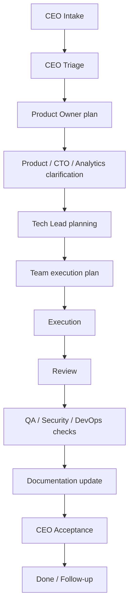

# WORKFLOW

## Назначение

Этот документ описывает процесс работы команды: цикл работы, правила, переходы задач, роли, review, handoff и обновление документации.

Процесс построен вокруг CEO-first модели: пользователь не ведет задачи руками, вся работа начинается через CEO Agent.

## Жизненный цикл проекта

Основной регламент выбирается в [PROJECT.md](../../01-product/strategy/PROJECT.md) по [типу проекта](../../07-project-types/README.md). Он определяет этапы, критерии и того, кто разрешает переход. Спринты и задачи выполняются в этих границах; их закрытие не завершает этап автоматически. Фактическое состояние и допуск принадлежат [STATE.md](../../01-product/strategy/STATE.md).

## Передача этапа на приёмку

Исполнитель передаёт принимающему:

1. Этап и номер цикла, краткий итог и соответствие согласованному объёму.
2. Проверяемые материалы и точную редакцию / сборку / период отчёта.
3. Выполненные проверки и свидетельства: устройства, окружения, сценарии, логи и ссылки.
4. Известные дефекты, непроверенные условия и внешние зависимости.
5. Следующий предлагаемый этап и необходимые для него полномочия.

В реестре `STATE.md` используется статус `review` и указанное состояние приёмки. В журнале фиксируются версия, материалы, фактическое решение, дата и источник ответа. Принятие результата и разрешение следующего этапа — отдельные решения. Замечания возвращают текущий этап на доработку и повторную передачу.

Если выбранный регламент требует приёмки пользователя, состояние передачи — «Ожидает проверки пользователя». Внутреннее review и решение CEO Agent этого принятия не заменяют. До явного разрешения работы следующего этапа не начинаются; молчание и успешные проверки не считаются согласием. После перерыва сначала читается последнее разрешённое действие в `STATE.md`.

Публикация результата спринта означает доставку в его разрешённый канал. Документ, прототип или внутренняя сборка могут быть результатом раннего этапа; это не даёт полномочий на модерацию или публичный выпуск. Внешние действия и расходы выполняются в границах `PROJECT.md` и выбранного этапа.

## Общий цикл



## Цикл спринта

Каждая итерация проекта проходит шесть обязательных этапов:

```text
Аналитика -> Планирование -> Разработка -> Тестирование -> Публикация -> Отчет
```

Содержание, владельцы, результаты и критерии перехода настраиваются под конкретный проект и платформу в [`SPRINT_REGULATION.md`](SPRINT_REGULATION.md). Текущие статусы этапов и подтверждения результатов фиксируются в [`PLAN.md`](../../01-product/planning/PLAN.md).

Этап можно адаптировать, но нельзя исключить. Спринт считается завершенным только после закрытия всех шести этапов и сохранения отчета. Возврат из тестирования или публикации в разработку повторно открывает все затронутые проверки.

## Планирование через CEO

Когда пользователь ставит работу через CEO Agent, например `CEO, сделай ...`, CEO Agent сначала выбирает уровень планирования:

| Уровень | Когда использовать | Что получает Product Owner |
| --- | --- | --- |
| `roadmap` | Направление, веха или крупная инициатива на несколько спринтов | Простое объяснение цели, ценности, вех, зависимостей, рисков и условия перехода в sprint / task |
| `sprint` | Набор задач на ограниченный период | Цель спринта, ожидаемый результат, scope, риски, задачи, owners и способ приемки |
| `task` | Один проверяемый результат | Зачем задача нужна, что будет готово, что не входит, риск, owner и ближайший шаг |

Для любого уровня CEO Agent обязан дать рабочий план для Product Owner простым языком. Для `sprint` и `task` дополнительно обязателен командный план выполнения.

Командный план должен содержать:

- одного owner для спринта или задачи;
- список агентов / ролей и их зоны ответственности;
- последовательные шаги, которые нельзя делать раньше предыдущих;
- параллельные работы, которые можно запускать одновременно;
- зависимости между агентами и артефактами;
- точки handoff между ролями;
- review, QA, security, docs и другие проверки по риску;
- критерий готовности, понятный CEO Agent и Product Owner.

## Статусы задач

Единый набор статусов для [`01-product/planning/PLAN.md`](../../01-product/planning/PLAN.md), task tracker и рабочих шаблонов: `todo | doing | review | done | blocked`.

`CEO Intake`, `Triage` и `Definition of Ready` остаются этапами процесса, но не являются статусами задач.

| Статус | Значение | Кто переводит |
| --- | --- | --- |
| `todo` | Задача находится в текущем спринте и еще не начата | CEO Agent / Product Manager / Tech Lead |
| `doing` | Работа выполняется owner | Owner |
| `review` | Изменения проверяются | Reviewer / QA |
| `done` | Результат принят | CEO Agent |
| `blocked` | Нужен ответ, решение или внешнее действие | Owner / CEO Agent |

## Правила работы

- Любая новая работа начинается через CEO Agent.
- У задачи всегда один owner.
- Owner отвечает за статус, handoff и проверку.
- CEO Agent всегда формирует рабочий план для Product Owner перед передачей работы вниз.
- Для `sprint` и `task` CEO Agent обеспечивает командный план: кто что делает, что идет последовательно, что идет параллельно и где зоны ответственности.
- Если задачу нельзя сделать без решения пользователя, CEO Agent задает короткий блокирующий вопрос.
- Если можно двигаться на разумном допущении, агент делает допущение и явно его помечает.
- Документация обновляется назначенным агентом, а не пользователем.

## Типовой процесс feature

1. User сообщает CEO Agent цель.
2. CEO Agent определяет уровень `roadmap | sprint | task`, приоритет и рабочий план для Product Owner.
3. Product Manager Agent формулирует ценность, scope и acceptance criteria.
4. Analyst Agent определяет baseline, метрики успеха и недостающий трекинг, если влияние функции должно измеряться.
5. CTO Agent подключается, если есть архитектурный или стратегический риск.
6. Tech Lead Agent декомпозирует работу и помогает CEO Agent уточнить командный план.
7. CEO Agent фиксирует owner, последовательные шаги, параллельные работы, зоны ответственности и handoff.
8. Developer Feature Agent реализует изменение.
9. Developer Test Writer Agent добавляет проверки, если нужно.
10. Developer Code Reviewer Agent проверяет изменения.
11. QA Agent подтверждает сценарии, а Analyst Agent — поступление и корректность новых событий.
12. Documentation Agent обновляет source of truth.
13. CEO Agent принимает результат.

## Типовой процесс bugfix

1. User или QA сообщает CEO Agent о проблеме.
2. CEO Agent определяет влияние и приоритет.
3. Tech Lead Agent назначает owner.
4. Developer Bug Fix Agent воспроизводит баг и находит root cause.
5. Исправление проходит review и regression check.
6. QA Agent подтверждает, что баг не воспроизводится.
7. Documentation Agent обновляет [`04-quality/BUGS.md`](../../04-quality/BUGS.md), если нужно.
8. CEO Agent закрывает задачу.

## Типовой процесс релиза

1. CEO Agent принимает решение готовить релиз.
2. Product Manager Agent подтверждает scope.
3. Tech Lead Agent проверяет готовность реализации.
4. QA Agent проходит обязательные проверки.
5. Security Agent подключается при security-sensitive изменениях.
6. DevOps Agent выполняет release checklist и деплой.
7. Analyst Agent проверяет качество данных и отслеживает post-release метрики, ошибки, монетизацию и отзывы в согласованном окне.
8. Documentation Agent обновляет changelog и операционные документы.
9. CEO Agent принимает go / no-go и итог релиза.

Этот процесс реализует этапы `Тестирование` и `Публикация` спринта, но не заменяет полный цикл из [`SPRINT_REGULATION.md`](SPRINT_REGULATION.md).

## Типовой процесс аналитики

1. User, CEO Agent или Product Manager Agent формулирует решение, для которого нужны данные, либо запускается регулярная проверка.
2. Analyst Agent проверяет доступы, свежесть источников, определения метрик и ограничения данных.
3. Analyst Agent выполняет анализ по доступным событиям и сравнивает сопоставимые периоды и сегменты.
4. Наблюдаемые факты отделяются от интерпретаций и гипотез.
5. Критичная аномалия сразу эскалируется Product Manager Agent, Tech Lead Agent и CEO Agent.
6. Результат фиксируется по [`ANALYTICS_REPORT_TEMPLATE.md`](../templates/ANALYTICS_REPORT_TEMPLATE.md), а рекомендации разделяются по десяти обязательным областям.
7. Analyst Agent формирует согласованный комплект: интерактивный `.html`, текстовый `.md` и snapshot `.json`.
8. Рекомендации получают приоритет, owner и следующий проверяемый шаг; изменения трекинга обновляют [`ANALYTICS.md`](../../01-product/growth/ANALYTICS.md).
9. CEO Agent или Product Manager Agent принимает решение по рекомендациям.

## Ветки

Ветки используются по правилам [`BRANCHING.md`](BRANCHING.md).

Коротко:

- не нужны для маленьких solo-изменений без риска;
- нужны для параллельной работы, review, релиза, конфликтов или рискованных изменений;
- назначаются Tech Lead Agent по поручению CEO Agent.

## Review

Review выполняется по [`REVIEW_POLICY.md`](REVIEW_POLICY.md).

Минимально нужно проверить:

- соответствие задаче;
- риски регрессий;
- тесты или ручную проверку;
- документацию;
- отсутствие секретов и случайных данных.

## Handoff

Handoff нужен, если:

- задача переходит между ролями;
- работа не завершена в один цикл;
- есть ветка или PR;
- есть риски, которые должен знать следующий участник.

Использовать [`../templates/HANDOFF_TEMPLATE.md`](../templates/HANDOFF_TEMPLATE.md).

## Definition of Done

Задача закрывается, когда:

- цель достигнута;
- проверки выполнены или явно указано, что не удалось проверить;
- review завершен, если нужен;
- баги записаны;
- документация обновлена;
- CEO Agent принял результат.

Для закрытия спринта дополнительно должны быть выполнены правила из [`SPRINT_REGULATION.md`](SPRINT_REGULATION.md): все шесть этапов закрыты, публикация достигла проектного критерия, отчет сохранен и связан с roadmap.
