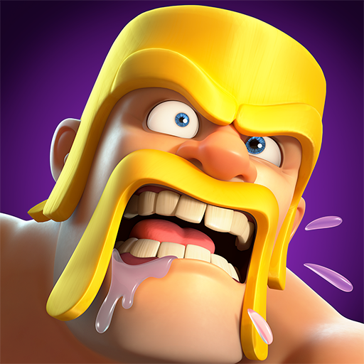
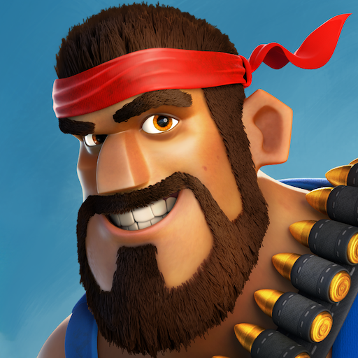
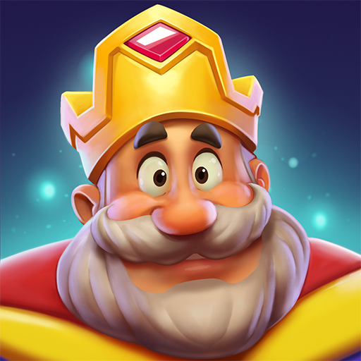
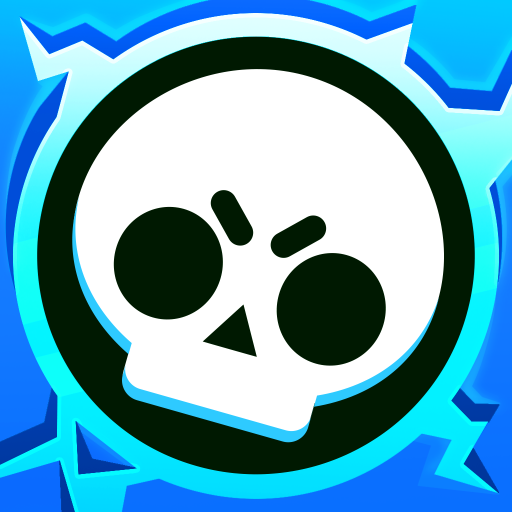

# Иконки игры

Иконка должна передавать характер игры одним узнаваемым объектом и читаться в небольшом размере. Ниже — требования магазинов, стандарт проекта и четыре примера.

## 1 Требования Google Play и App Store

| Платформа | Требования и способ передачи |
| --- | --- |
| Google Play | 512×512, 32-bit PNG, sRGB, до 1024 KB. Полный квадрат; внешнюю тень и скругление добавляет магазин. [Спецификация Google](https://developer.android.com/distribute/google-play/resources/icon-design-specifications) |
| Google Play | Исключить вводящие в заблуждение элементы, рейтинги, цены и рекламные бейджи. Иконка магазина и адаптивная иконка Android — отдельные ресурсы. [Спецификация Google](https://developer.android.com/distribute/google-play/resources/icon-design-specifications) |
| App Store для iOS и iPadOS | Для пути через Asset Catalog используется изображение 1024×1024. Альтернатива — Icon Composer с подключением в Xcode. Иконка поступает в App Store Connect вместе со сборкой. [Настройка AppIcon](https://developer.apple.com/documentation/xcode/configuring-your-app-icon), [добавление иконки](https://developer.apple.com/help/app-store-connect/manage-app-information/add-an-app-icon) |
| App Store | Иконки и прочие метаданные должны соответствовать игре и не путать пользователя; обновление опубликованной иконки требует новой версии приложения. [Правила 2.3](https://developer.apple.com/app-store/review/guidelines/#accurate-metadata), [добавление иконки](https://developer.apple.com/help/app-store-connect/manage-app-information/add-an-app-icon) |

Для конкретной сборки проверяются варианты оформления иконки, поддерживаемые выбранными Xcode и платформой. Плоский PNG и проект Icon Composer подготавливаются по своему пути интеграции.

## 2 Стандарт проекта

| Элемент | Стандарт |
| --- | --- |
| Главный объект | Один герой, предмет или символ; виден сразу |
| Фон | Чистый или спокойный, без конкурирующих объектов и мелкого узора |
| Композиция | Крупный объект и ясный силуэт; важная часть остаётся видимой после системной маски |
| Контраст | Объект отделён от фона тоном, цветом или светом |
| Персонаж | Одна понятная эмоция; глаза и лицо читаются при уменьшении |
| Текст | По умолчанию отсутствует; мелкие надписи и слоганы не используются |
| Связь с игрой | Собственный персонаж или предмет, палитра и стиль самой игры |
| Проверка | Просмотр в 512, 64 и 32 px, на светлом и тёмном окружении; проверка фактической иконки в сборке |
| Экспорт | Отдельные файлы под магазины; для плоского исходника — квадратный PNG с непрозрачным фоном, без нарисованной внешней маски |

## 3 Референсы

| [Clash of Clans](https://play.google.com/store/apps/details?id=com.supercell.clashofclans) | [Boom Beach](https://play.google.com/store/apps/details?id=com.supercell.boombeach) | [Royal Match](https://play.google.com/store/apps/details?id=com.dreamgames.royalmatch) | [Brawl Stars](https://play.google.com/store/apps/details?id=com.supercell.brawlstars) |
| --- | --- | --- | --- |
|  |  |  |  |
| Крупное лицо и сильная эмоция | Персонаж отделён от спокойного фона | Дружелюбное выражение и читаемые глаза | Простой символ с сильным силуэтом |

Все четыре файла — оригиналы 512×512. Источники и контрольные суммы — в [реестре](../SOURCES.json). [Вся подборка](../README.md).
