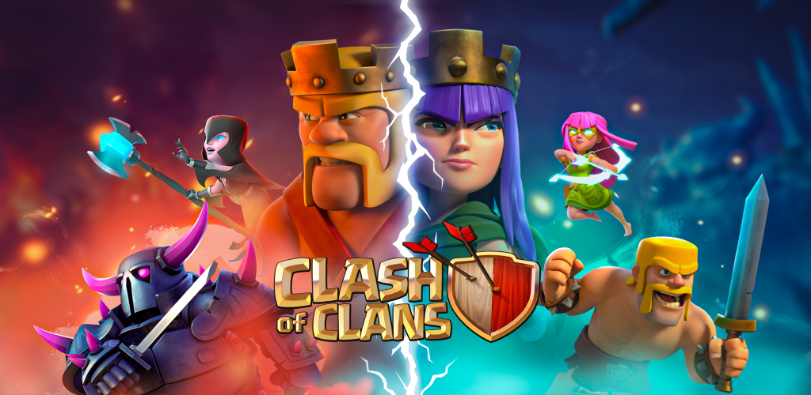
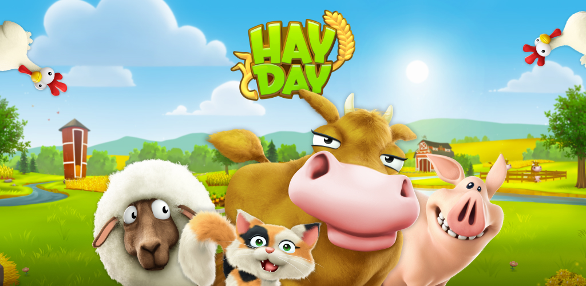
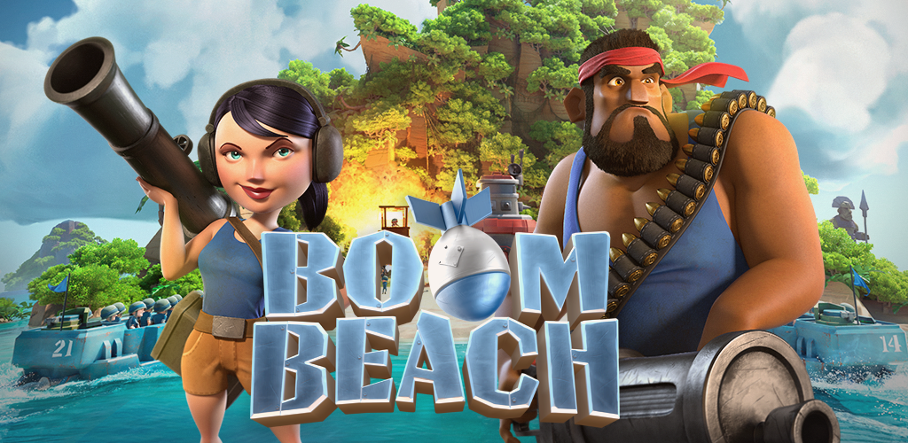
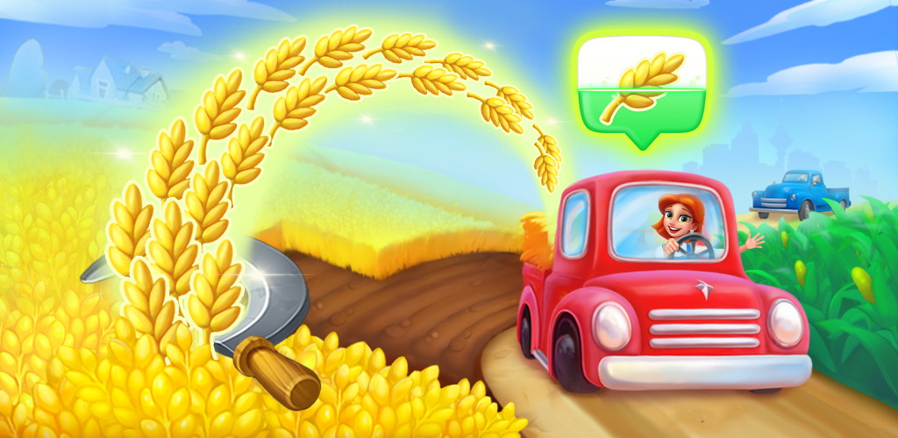

# Рекомендуемое изображение и промографика игры

В Google Play «Рекомендуемое изображение» — Feature Graphic 1024×500. Оно передаёт характер или основную механику игры одной сценой. Для App Store подготавливаются отдельные creative assets под конкретное размещение.

## 1 Требования Google Play и App Store

| Платформа и размещение | Требования |
| --- | --- |
| Google Play Feature Graphic | Обязательный ресурс страницы: 1024×500, JPEG либо 24-bit PNG без alpha. Может использоваться в рекомендациях и как обложка превью. [Спецификация Google](https://support.google.com/googleplay/android-developer/answer/9866151?hl=en) |
| Google Play рекомендации по подаче | Главные элементы ближе к центру, с учётом обрезки и наложений интерфейса; без перегрузки деталями. Исключить цены, рейтинги и рекламные бейджи; локализовать добавленный текст. [Рекомендации Google](https://support.google.com/googleplay/android-developer/answer/9866151?hl=en) |
| App Store Product page header | Отдельный формат: 3840×1646, PNG без alpha. Это промографика заголовка страницы, а не экспорт Google Play. [Спецификация Apple](https://developer.apple.com/help/app-store-connect/reference/app-information/creative-assets-specifications) |
| App Store Search results | 3:2, от 1920×1280 до 3840×2560, JPEG или PNG без alpha. [Спецификация Apple](https://developer.apple.com/help/app-store-connect/reference/app-information/creative-assets-specifications) |
| App Store Universal asset | 5244×2950, PNG без alpha; общая композиция для header и поиска с собственной безопасной областью. [Спецификация Apple](https://developer.apple.com/help/app-store-connect/reference/app-information/creative-assets-specifications) |

Для App Store выбирается доступное размещение; изображения готовятся по его актуальному шаблону Art Safe Area и проверяются в Asset Library. Размер 1024×500 относится к Google Play и не заменяет эти форматы. [Шаблоны и размеры Apple](https://developer.apple.com/help/app-store-connect/reference/app-information/creative-assets-specifications), [работа с ресурсами App Store](https://developer.apple.com/help/app-store-connect/manage-app-information/manage-your-app-store-assets).

## 2 Стандарт проекта

| Элемент | Стандарт |
| --- | --- |
| Основная мысль | Одна сцена, раскрывающая механику, настроение или основной конфликт игры |
| Главный объект | Один визуальный центр; персонажи и предметы подчинены общей композиции |
| Фон | Поддерживает жанр и действие; мелкие детали не конкурируют с главным объектом |
| Контраст | Главный объект читается в небольшом превью и отделён от окружения |
| Текст | Необязателен; если нужен — одна мысль, ориентир 3–6 слов, без мелкого абзаца |
| Логотип | По необходимости и условиям размещения; не занимает изображение целиком |
| Безопасная область | Ключевые элементы внутри безопасной области целевого шаблона; фон продолжается к краям |
| Связь с игрой | Узнаваемые собственные персонажи, предметы и палитра; сцена соответствует содержанию продукта |
| Исходник | Композиция с запасом по краям и отдельными слоями; хранится также версия без текста |
| Экспорт | Макеты Google Play и App Store компонуются отдельно; широкое изображение не получается растяжением другого формата |
| Проверка | Уменьшенное превью, обрезка под размещение, читаемость текста и фактический предпросмотр магазина |

## 3 Референсы

Четыре сохранённых оригинала Google Play, каждый 1024×500.

| [Clash of Clans](https://play.google.com/store/apps/details?id=com.supercell.clashofclans) | [Hay Day](https://play.google.com/store/apps/details?id=com.supercell.hayday) |
| --- | --- |
|  |  |
| Общая композиция персонажей передаёт конфликт и характер игры | Светлая палитра и животные передают атмосферу фермы |

| [Boom Beach](https://play.google.com/store/apps/details?id=com.supercell.boombeach) | [Township](https://play.google.com/store/apps/details?id=com.playrix.township) |
| --- | --- |
|  |  |
| Крупные герои на переднем плане, окружение раскрывает жанр | Действие становится главным образом: урожай, инструмент и машина |

Источники отдельных файлов и контрольные суммы — в [реестре](../SOURCES.json). [Вся подборка](../README.md).
