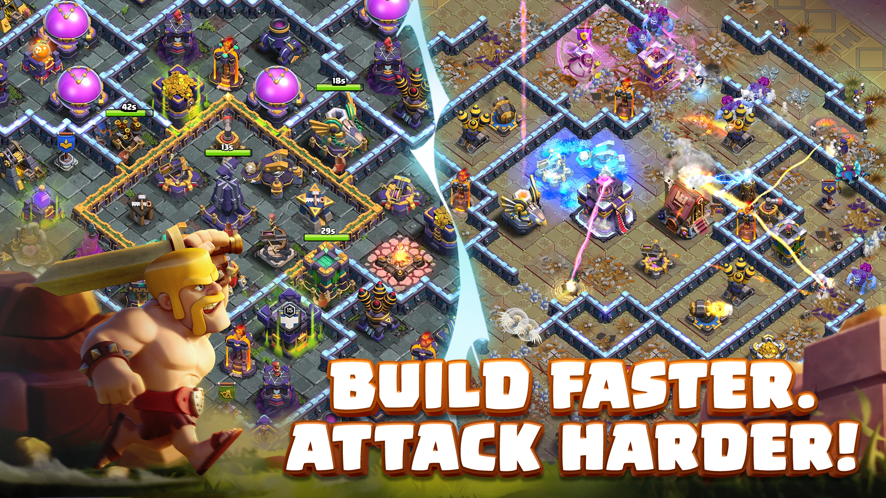
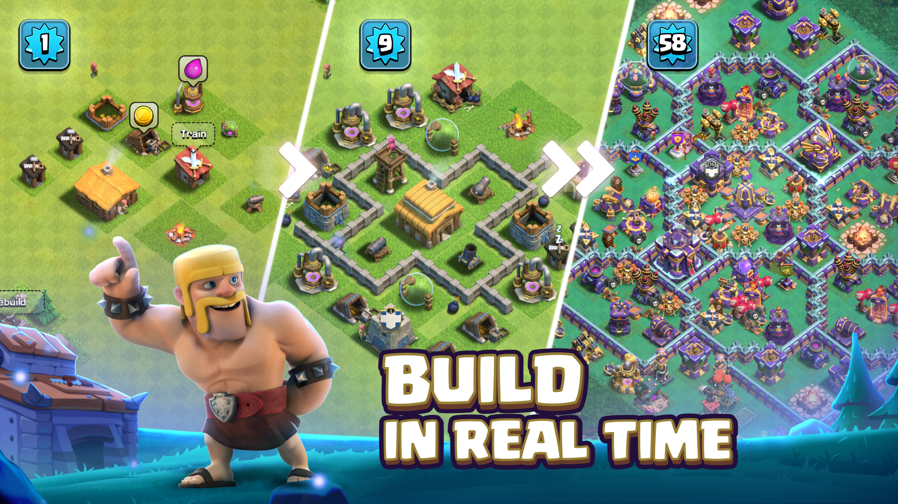
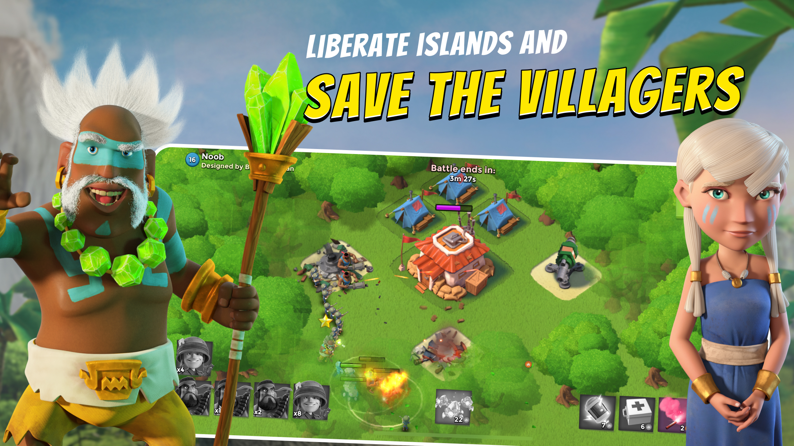
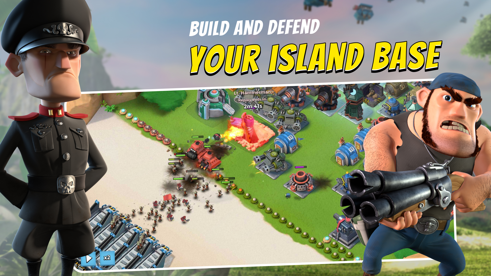
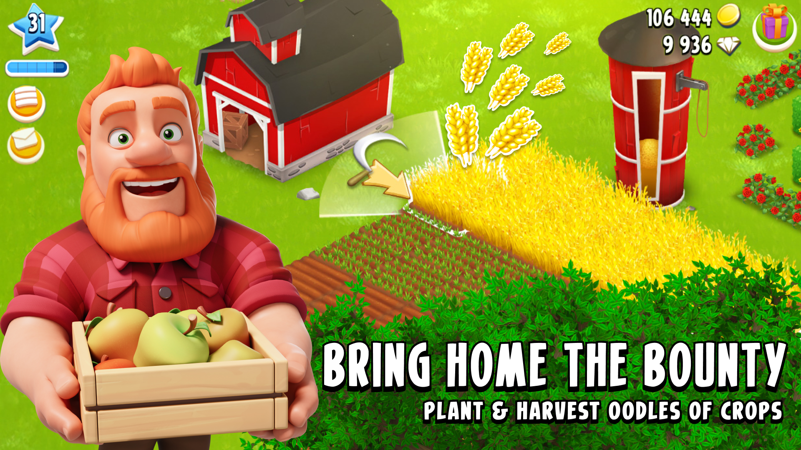
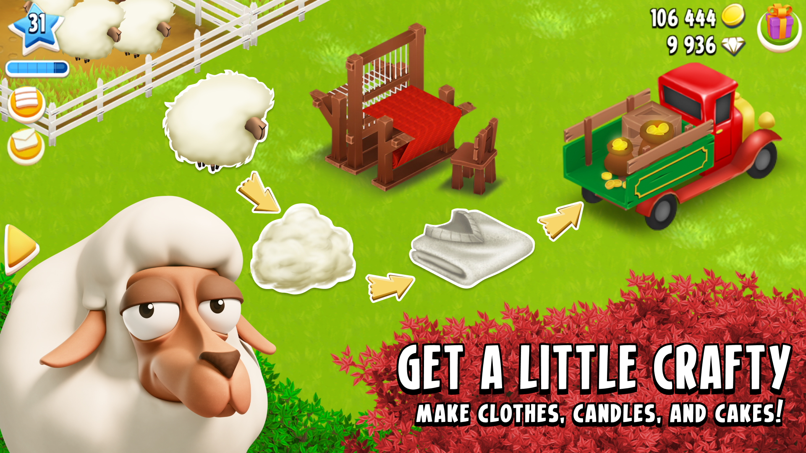
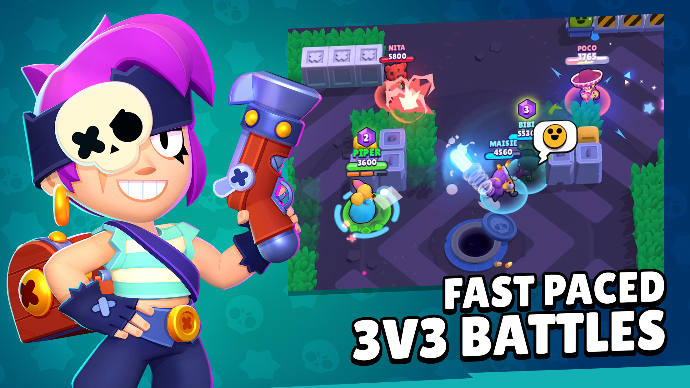
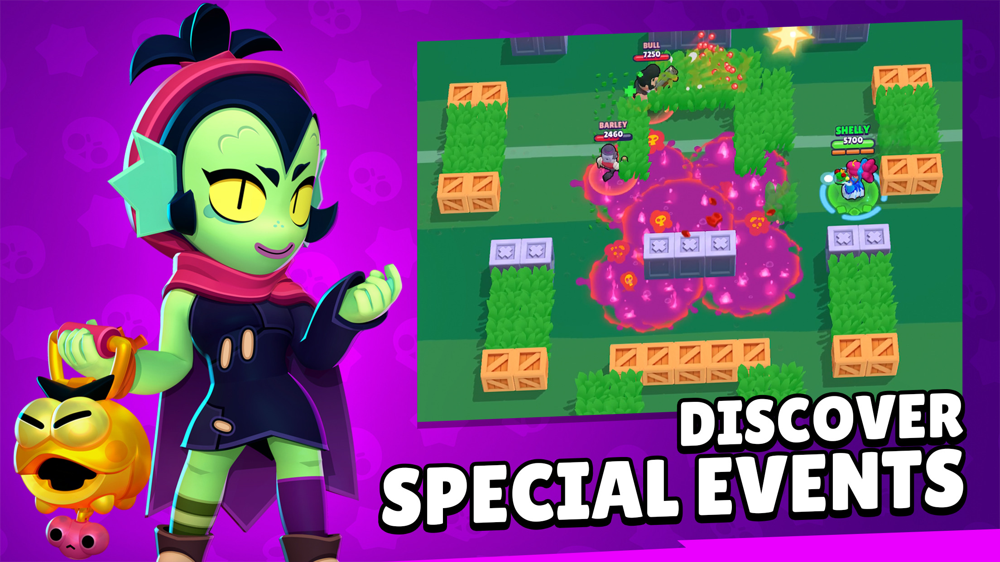

# Скриншоты игры для магазинов

Комплект показывает реальные действия игрока и причины продолжить игру. Один кадр передаёт одну основную мысль; заголовок помогает быстро прочитать действие.

## 1 Требования Google Play и App Store

| Платформа | Требования |
| --- | --- |
| Google Play | Для публикации минимум 2 скриншота; до 8 на поддерживаемый тип устройства. JPEG или 24-bit PNG без alpha, стороны 320–3840 px; отношение большей стороны к меньшей не выше 2,3. [Спецификация Google](https://support.google.com/googleplay/android-developer/answer/9866151?hl=en) |
| Google Play для форматов рекомендаций | Минимум 3 игровых кадра 16:9 от 1920×1080 либо 9:16 от 1080×1920. Добавленные подписи — не больше 20% изображения. Это условия соответствующих рекомендательных форматов. [Рекомендации Google](https://support.google.com/googleplay/android-developer/answer/9866151?hl=en) |
| App Store | От 1 до 10 скриншотов на размер устройства; JPEG, JPG или PNG без alpha и прозрачности. [Спецификация Apple](https://developer.apple.com/help/app-store-connect/reference/app-information/screenshot-specifications) |
| App Store для iPhone | Требуется набор для iPhone с Dynamic Island среднего размера. Допустимые горизонтальные размеры этой группы: 2556×1179 или 2622×1206. Остальные группы и правила масштабирования — в [спецификации Apple](https://developer.apple.com/help/app-store-connect/reference/app-information/screenshot-specifications). |
| App Store для iPad | При поддержке iPadOS нужен набор для 13-дюймового iPad; допустим, например, горизонтальный размер 2752×2064. [Спецификация Apple](https://developer.apple.com/help/app-store-connect/reference/app-information/screenshot-specifications) |

Оба магазина требуют достоверной подачи игрового опыта. Apple допускает текстовые и графические пояснения поверх кадров, но скриншоты должны показывать игру в использовании. Для Google Play первые три кадра по возможности посвящаются игровому интерфейсу. [Apple 2.3.3](https://developer.apple.com/app-store/review/guidelines/#accurate-metadata), [Google Play](https://support.google.com/googleplay/android-developer/answer/9866151?hl=en).

## 2 Стандарт проекта

| Элемент | Стандарт |
| --- | --- |
| Основная мысль | Один кадр — одно действие или преимущество |
| Заголовок | 3–6 слов; одна основная фраза, обычно 1–2 строки |
| Описание | Необязательно; максимум одна короткая строка, если заголовка недостаточно |
| Контраст | Крупный читаемый текст; обводка, тень или спокойная подложка при необходимости |
| Игровое действие | Главную площадь занимает понятный момент из принятой сборки; важные элементы управления не перекрыты |
| Ориентация | Предпочтительна горизонтальная композиция, если она достоверно показывает игру; портретный процесс не растягивается и не подменяется горизонтальным |
| Формат | Для Google Play базовый горизонтальный экспорт 1920×1080; для App Store — отдельная компоновка под выбранную группу устройств |
| Комплект | Обычно 4–8 кадров: основной процесс → развитие → препятствия или усиления → долгосрочная цель; события — если есть в игре |
| Первые кадры | Сразу объясняют, что делает игрок; декоративный постер не заменяет показ процесса |
| Единство | Один шрифт, расположение заголовков, цветовые роли и способ оформления игровых сцен |
| Локализация | Свой экспорт подписей для каждого языка; текст не обрезается |
| Проверка | Читать в размере превью магазина; проверить реальную сборку, последовательность кадров и предпросмотр каждой платформы |

Пример структуры подписи: **«Сортируй по цветам»**; пояснение при необходимости: «Освобождай место для новых предметов». Текст применяется только при наличии такого действия в игре.

## 3 Референсы

Сохранены четыре полных комплекта в исходном порядке: 8, 6, 8 и 8 кадров. Все изображения горизонтальные 16:9, с разрешением 1920×1080 или 2208×1242. Ниже по два показательных кадра из каждого комплекта; остальные доступны по номерам.

### Clash of Clans

[Источник](https://play.google.com/store/apps/details?id=com.supercell.clashofclans). Крупный контрастный заголовок и показ развития базы. Берём читаемость и понятное разделение тем между кадрами.

| Развитие и атака | Строительство |
| --- | --- |
|  |  |

Весь комплект: [01](clash-of-clans-01.png), [02](clash-of-clans-02.png), [03](clash-of-clans-03.png), [04](clash-of-clans-04.jpg), [05](clash-of-clans-05.jpg), [06](clash-of-clans-06.jpg), [07](clash-of-clans-07.jpg), [08](clash-of-clans-08.jpg).

### Boom Beach

[Источник](https://play.google.com/store/apps/details?id=com.supercell.boombeach). Короткая вводная строка и выделенная главная мысль; игровое действие находится между персонажами.

| Освобождение островов | Защита базы |
| --- | --- |
|  |  |

Весь комплект: [01](boom-beach-01.jpg), [02](boom-beach-02.jpg), [03](boom-beach-03.jpg), [04](boom-beach-04.jpg), [05](boom-beach-05.jpg), [06](boom-beach-06.jpg).

### Hay Day

[Источник](https://play.google.com/store/apps/details?id=com.supercell.hayday). Каждый кадр объясняет отдельное занятие; стрелки показывают связь действия и результата. Описание используется как второстепенная строка.

| Выращивание и сбор | Производство предметов |
| --- | --- |
|  |  |

Весь комплект: [01](hay-day-01.jpg), [02](hay-day-02.jpg), [03](hay-day-03.jpg), [04](hay-day-04.jpg), [05](hay-day-05.jpg), [06](hay-day-06.jpg), [07](hay-day-07.jpg), [08](hay-day-08.png).

### Brawl Stars

[Источник](https://play.google.com/store/apps/details?id=com.supercell.brawlstars). Белый текст с тёмной обводкой, цветовая подложка и отдельная область игрового действия. Для нашего комплекта приоритетны кадры с самим процессом.

| Сражения | События |
| --- | --- |
|  |  |

Весь комплект: [01](brawl-stars-01.jpg), [02](brawl-stars-02.jpg), [03](brawl-stars-03.jpg), [04](brawl-stars-04.jpg), [05](brawl-stars-05.jpg), [06](brawl-stars-06.jpg), [07](brawl-stars-07.jpg), [08](brawl-stars-08.jpg).

Источники отдельных файлов и контрольные суммы — в [реестре](../SOURCES.json). [Вся подборка](../README.md).
